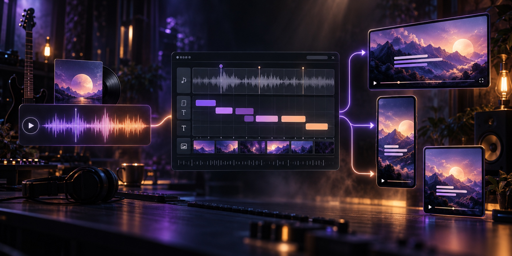

# LyricFast

### AI lyric videos for every release format

[Visit Website](https://lyricfast.com/) · [Make a Video](https://lyricfast.com/create) · [Free Lyric Video Maker](https://lyricfast.com/free-lyric-video-maker) · [Pricing](https://lyricfast.com/pricing)

## What is LyricFast?

[LyricFast](https://lyricfast.com/) is an AI lyric video maker built for musicians and creators who need a complete release kit without working through a traditional editing timeline.

Upload a song, review the automatically synchronized lyrics, correct only the words that need attention, add a visual style, and export platform-ready videos for YouTube, Shorts, TikTok, and social feeds.

## What you can create

- **Widescreen lyric videos** for YouTube in 16:9
- **Vertical lyric videos** for TikTok, Reels, and Shorts in 9:16
- **Square lyric videos** for social feeds in 1:1
- **On-brand release visuals** using cover art, custom backgrounds, or built-in scenes
- **Reusable release kits** that keep the same timing and visual identity across formats

## Core workflow

1. Upload an MP3, WAV, M4A, OGG, or FLAC track up to 10 minutes long.
2. Let AI synchronize the lyrics at word level.
3. Review the full-song browser preview and fix highlighted low-confidence words.
4. Choose a music-first template or upload a JPG, PNG, or WebP background.
5. Render the project for widescreen, vertical, or square delivery.

## Why creators use it

### Independent musicians

Turn a finished track into a coordinated release package without rebuilding the same video for every platform.

### Labels and creative teams

Keep typography, backgrounds, timing, and framing consistent across a catalog while retaining a fast review step for lyrics.

### YouTube and social releases

Publish a full lyric video, a vertical short, and a square feed post from the same project and synchronized source.

### Fast corrections

Fix lyric typos, adjust the visual template, or change the aspect ratio without rebuilding the project from scratch. Eligible project-based plans allow re-renders without buying the same project again.

## Product highlights

| Capability | What it does |
| --- | --- |
| Word-level synchronization | Matches lyric timing to the vocal automatically |
| Confidence review | Highlights uncertain words so creators can focus corrections |
| Full-song preview | Lets creators review timing before rendering |
| Custom visual identity | Supports cover art and JPG, PNG, or WebP backgrounds |
| Music-first templates | Offers eight styles designed for different music releases |
| Multi-format delivery | Produces 16:9, 9:16, and 1:1 versions from one project |

## Explore LyricFast

| Destination | Link |
| --- | --- |
| Create a lyric video | [Open the creator](https://lyricfast.com/create) |
| Free workflow | [Try the free lyric video maker](https://lyricfast.com/free-lyric-video-maker) |
| Plans and features | [View pricing](https://lyricfast.com/pricing) |
| Product overview | [Visit LyricFast](https://lyricfast.com/) |

## Review before publishing

Always review lyric spelling, word timing, safe zones, crops, and background contrast before publishing. Only upload music, lyrics, artwork, and other assets that you own or are authorized to use.

## About this repository

This is the public product overview repository for LyricFast. The application source code is proprietary and maintained privately. For product access, current features, pricing, and support, visit [lyricfast.com](https://lyricfast.com/).
